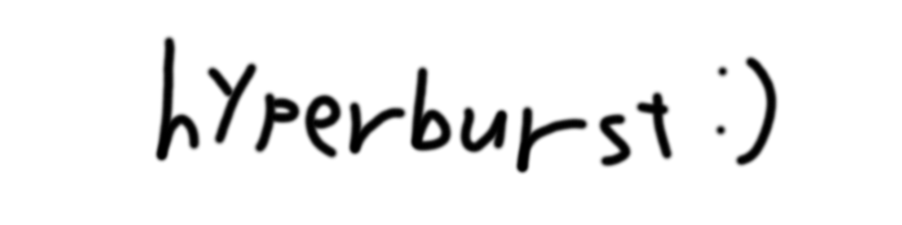

<p align="center"></p>

# Qwen3.8-Flash-Next を RTX PRO 6000 Blackwell Max-Q 1 枚で速く動かした記録

[English README](README.md)

AI の言語モデル **Qwen3.8-Flash-Next**(NVFP4 という 4 ビット形式の版)を、
**NVIDIA RTX PRO 6000 Blackwell Max-Q(メモリ 96 GB、消費電力 300〜325 W の省電力版)1 枚**で速く動かした方法と、
うまくいかなかったことの記録です。
変更のパッチ列、FlashInfer への変更、起動スクリプト、計測用ツール、文章を除いた計測結果、作業の記録を含みます。

今の版は、フォークの `flash-next-fast` ブランチにあります(2026 年 10 月 27 日の更新)。1 件ずつの処理の高速化を残しながら、
長い文脈のリクエストを 4 件同時に処理できるようにしました。

> **土台は [jpezzulli/sglang-rtxpro6000](https://github.com/jpezzulli/sglang-rtxpro6000) です。**
> そのフォークにある Flash-Next のモデル実装(QSA、ハイパーコネクション、PLE、MTP、メモリプール)は、
> SGLang の未マージのプルリクエスト [#36497](https://github.com/sgl-project/sglang/pull/36497)
> (Qwen 3.8 Flash-Next。Qiaolin-Yu さんと共著者 ch-wan、ispobock、JustinTong0323、samuellees、YAMY1234、
> yhyang201、yizhang2077、zijiexia の各氏)を取り込んで手直ししたもので、GDN の MTP 状態は未マージの
> [#30967](https://github.com/sgl-project/sglang/pull/30967)(RecoverSSM)を元にしています。
> John Pezzulli さんの仕事は、それをこの GPU(SM120)で動かす統合と検証、リカバリ用 CUDA グラフ、
> HiCache/NIXL による保存などです(フォークの `CHANGES.md` と `PROVENANCE.md` を参照)。私たちの仕事は、その上に積んだ 121 個の変更と、FlashInfer という部品への
> 10 個の変更です(9 月の結果に使ったのはそのうち 105 個と 7 個、残りは 2026-10-02 版のもの)。まずそちらのプロジェクトを見て、クレジットしてください。

## 結果

最終リリース(2026-10-27)、公開の部品のみ(フォークの公開トークンマップと、チェックポイントの元の MTP ヘッド)。
1 件ずつ、greedy、思考あり、画面 OFF、各ビルド 1 起動。
セルは、クライアント側で測った生成速度の平均 t/s(最小〜最大)で、各ジャンル 8 問です。

| 版 | コード編集 | 英語の文章 | 日本語の文章 | エージェント |
|---|---|---|---|---|
| `normal` | 611 (529–680) | 279 (272–285) | 288 (265–371) | 382 (357–410) |
| `hyperpro` | 657 (575–731) | 270 (259–294) | 288 (257–339) | 367 (350–389) |

- BetterBench 0.6.0、同じ公開の部品: c=1 の生成速度は 369.9(normal)と 342.3(hyperpro)tok/s、
  4 件同時の合計は 710.2 と 693.7 tok/s でした。
- 各ビルド 1 起動だけです。数 % の差は実行ごとのぶれとして扱ってください。
- 2026-11-08 の束 2: 1 枠の測りで約 +3%(431.0 → 443.6 tok/s、+2.91%)。これは非公開の MTP ヘッドで測った数字なので、
  上の表とは t/s の絶対値が違います。[測定と但し書き](docs/bundle2-measurements.md)(英語)を参照してください。
- 全部の表・当たり数・条件: [2026-10-27 の計測結果](docs/ja/updates/2026-10-27.md#計測結果)。
- 古い数字: 過去の 9 月と 2026-10-02 の作業で、1 件ずつの生成は 1 秒に約 130〜210 トークンから約 260〜670 トークンになりました
  (文章の種類によって違う)。[2026-09](docs/ja/updates/2026-09.md) と [2026-10-02](docs/ja/updates/2026-10-02.md) を参照してください。

## 使う前に

1. **GPU とモデル。** RTX PRO 6000 Blackwell (96 GB)。ほかの sm120 カードは未検証です。
   重みは含みません。Normal は RadixArk/Qwen3.8-Flash-Next-NVFP4、hyper pro はそのモデルに
   ThinkingCap を重ねた手元のオーバーレイを使います。
2. **メインメモリ。** 既定設定のサーバープロセスで約 100 GiB(実測の最大 100.5 GiB)。
   プールを減らすには `FLASH_NEXT_HICACHE_GB` を下げます。メモリを減らす設定は
   [必要なものと起動方法](docs/ja/updates/2026-10-27.md#必要なものと起動方法)にあります。
3. **VRAM。** 最大 4 件同時、それぞれ 262,144 トークンの文脈で、画面表示用に VRAM を 7 GB 残します
   (`DISPLAY_RESERVE_GB=7`)。任意の専門家の置き場で VRAM を減らせます(「版と設定」参照)。
4. **初回起動では nvcc でカーネルをコンパイルします。** aiueo52 と貢献者が使ったマシンでは、
   14 モジュールで約 47 min(時間は上限の目安)、メモリの最大使用量は約 20 GiB でした。`PATH` に `nvcc`、ホスト側の C++ コンパイラー、`ninja` が必要です。
5. **出力。** Hyper pro は OEA(近似の MoE 経路)を有効にするので、出力が少し変わります。
   過去の実行では、greedy 設定でも毎回まったく同じ答えにはなりませんでした(「限界と注意」参照)。
6. **セキュリティ。** サーバーは 127.0.0.1 で待ち受けます。推論用の経路は既定では認証なしです。
   **認証するプロキシなしでネットワークに公開しないでください。**
   詳しくは[サーバーへのアクセスと秘密の伏せ字](docs/ja/updates/2026-10-27.md#サーバーへのアクセスと秘密の伏せ字)。

## 動かし方

フォークのブランチを取得したあと、上流の
[`BUILD.md`](https://github.com/jpezzulli/sglang-rtxpro6000/blob/16e5682aad6e3335f38ec8d5711176278f12a086/BUILD.md)
に従って venv を作り、有効にしてください(Python 3.12、PyTorch 2.13.0+cu130、FlashInfer 0.6.17、`nvcc` を含む CUDA 13 ツールキット)。
検証したのは、その venv と `serve-fast.sh` の組み合わせだけです。**このブランチを pip でインストールする方法(例: `pip install ./python`)は未検証・非対応です**。

```bash
git clone --branch flash-next-fast https://github.com/aiueo52/sglang-rtxpro6000.git
cd sglang-rtxpro6000
# 上流の BUILD.md に従って venv を作り、有効にしてから続けてください。
python3 -m pip install flashinfer-python==0.6.17 ninja
python3 tools/assemble_flashinfer.py
export TARGET_MODEL=/path/to/Qwen3.8-Flash-Next-NVFP4   # hyper pro: model-overlay-orig ディレクトリ
CONC=4 FLASH_NEXT_EDITION=normal bash serve-fast.sh wa  # hyper pro は FLASH_NEXT_EDITION=hyperpro
```

サーバーは `PORT`(既定 `8001`)で、モデル名 `flash-next` の OpenAI 互換 API を `/v1` 以下で提供します。
全部の手順と設定: [必要なものと起動方法](docs/ja/updates/2026-10-27.md#必要なものと起動方法)と
[フォークの README](https://github.com/aiueo52/sglang-rtxpro6000/blob/d21289fb923ac65b7b913b73c6e32a2fa2601e7b/README.md)。

## 版と設定

| 名前 | 何をするか | 詳しく |
|---|---|---|
| `normal` 版(既定) | Qwen3.8-Flash-Next NVFP4 | [2026-10-27](docs/ja/updates/2026-10-27.md) |
| `hyperpro` 版 | ThinkingCap (Qwen3.8-Flash-Next NVFP4)。OEA 有効 | [動作中の OEA 制御](docs/ja/updates/2026-10-27.md#動作中の-oea-制御hyperpro) |
| `CONC=4`(既定)/ `CONC=1` | `CONC=1` は同時に受け付ける数を 1 件に制限する設定ではありません。`CONC=6` は未検証です | [同時処理](docs/ja/updates/2026-10-27.md#同時処理と先読み幅の設定) |
| `EXPERT_TIER_K=<K>`(任意) | MoE の層ごとに K 人の専門家を VRAM に置きます。既定は切 | [専門家の置き場](docs/ja/updates/2026-10-27.md#任意-専門家の置き場vram-を減らす) |
| `HB_BUNDLE2=1`(フォークの既定) | 測った `wa` の構成のときに H35a と H38 の旗を設定します | [2026-11-08](docs/ja/updates/2026-11-08.md) |
| `wa` 設定 | 先読み幅を自動で切り替え | [どうやって速くしたか](docs/ja/how-it-works.md) |
| `w4` / `w16` 設定 | 先読み幅 4 / 先読み幅 16(過去の 9 月の表) | [2026-09](docs/ja/updates/2026-09.md) |

## どうやって速くしたか(短い説明)

1 件ずつ処理するとき、1 回の計算で GPU は、モデルの重みをメモリから読みながら、小さな計算を長く順番に行います。
速くする方法は 2 つです: **1 回の計算で確定できる文字数を増やす(先読み)**ことと、**1 回の計算にかかる時間を減らす**ことです。
日付のない項目は、過去の 9 月と 2026-10-02 の構成のものです。

- **広く、軽い先読み:** 候補の単語を絞った表(トークンマップ)、広い先読み幅、幅を自動で切り替える仕組み(`wa`)、
  追加学習した MTP ヘッド。
- **重みを 8 ビット(FP8)で読む**、Triton で自作した W8A16 GEMV。
- **小さな計算をまとめて減らす:** KV-FP8 の書き込みの融合、ハイパーコネクションの混合、正規化の融合など。
- **専門家(MoE)部分の段取りを FlashInfer の中でまとめた:** CUTLASS の fused-MoE 経路への 6 個の変更。
- **1 か所からしか使われない専門家の計算の省略:** モデルの計算結果を変えます。`PRUNE_TAU=0` で無効にできます。
- **2026-10-02:** 固定の手間の削減、温度ありの出力の正しさの修正、リジェクションサンプリング、指定したときだけの 524,288 トークンの文脈。
- **2026-10-27:** 最大 4 件同時、メインメモリの階層型プレフィックスキャッシュ、先読み幅を自動調整する MTP 投機的デコード。

全文: [`docs/ja/how-it-works.md`](docs/ja/how-it-works.md)。項目ごとの根拠: [`docs/optimizations.md`](docs/optimizations.md)(英語)。
理屈の上限: [`docs/roofline.md`](docs/roofline.md)(英語)。

## うまくいかなかったこと

失敗した実験も、採用したものと同じくらい役に立ちます。例: 標準の 8 ビット計算(CUTLASS W8A8 GEMM)、n-gram の先読み、
重みを 4 ビット(NVFP4)にした GEMV、1 つの巨大な計算にまとめる方式(megakernel)、GPU の L2 キャッシュへの先読み。
一覧: [`docs/ja/what-did-not-work.md`](docs/ja/what-did-not-work.md)。数字の全部: [`docs/rejected.md`](docs/rejected.md)(英語)。

## 自分で再現するには

2026-10-27 のフォークは上の「動かし方」に従ってください。以下は過去の 2026-10-02 の構成を作り直す手順です。
[`docs/reproduce.md`](docs/reproduce.md) に詳しい手順があります(英語)。概要: 土台フォークを取得 → `patches/sglang/apply.sh` →
環境を作る → `patches/flashinfer/apply.sh` → モデルをダウンロード → 公開の候補単語の表 `tokenmaps/public/public_49152.pt` を使うか、自分で作る(`tokenmaps/`)→
`launch/serve-fast.sh wa` で起動 → `bench/` の `fnbench` で計測。

## 限界と注意

全部の一覧(過去の 9 月と 2026-10-02 の構成): [`docs/ja/limitations.md`](docs/ja/limitations.md)。

- **公開していないもの。** 追加学習した先読み役(MTP ヘッド)と非公開の候補単語の表は公開していません。
  計測では、公開の部品のほうが遅い結果でした(数字は各更新のページ)。
- **問題文の種類が少ない。** 「考える」モード ON なので、数えたトークンの大半は考えている途中の文字です。
- **計測のぶれ。** 同じ GPU で 4K・160 Hz の画面も表示しています。比較は同じ時間帯に行いました。
- **毎回まったく同じ答えにはならない。** 一部の計算が足し算の順番に依存するため、greedy 設定でも出力や当たりが少し変わります。
- **省略(枝刈り)はモデルの計算を変えます。** 「差が見つからない」は「劣らないことの証明」ではありません。

## 読むページ

| したい事 | 読むページ |
|---|---|
| 今のリリースを動かす | [必要なものと起動方法](docs/ja/updates/2026-10-27.md#必要なものと起動方法)、[フォークの README](https://github.com/aiueo52/sglang-rtxpro6000/blob/d21289fb923ac65b7b913b73c6e32a2fa2601e7b/README.md) |
| 今の結果を全部見る | [2026-10-27 の計測結果](docs/ja/updates/2026-10-27.md#計測結果) |
| 過去の 2026-10-02 の構成を作り直す | [`docs/reproduce.md`](docs/reproduce.md)(英語) |
| それぞれの工夫が何をするか知る | [`docs/optimizations.md`](docs/optimizations.md)(英語)、[`docs/ja/how-it-works.md`](docs/ja/how-it-works.md) |
| 失敗したものを見る | [`docs/rejected.md`](docs/rejected.md)(英語)、[`docs/ja/what-did-not-work.md`](docs/ja/what-did-not-work.md) |
| 速さの上限を知る | [`docs/roofline.md`](docs/roofline.md)(英語) |
| 数字の測り方を確かめる | [`docs/measurement.md`](docs/measurement.md)(英語)、[`docs/ja/limitations.md`](docs/ja/limitations.md) |
| 自分の候補単語の表を作る | [`tokenmaps/README.md`](tokenmaps/README.md)(英語) |
| 自分の MTP ヘッドを学習する | [`docs/train-your-own-mtp-head.md`](docs/train-your-own-mtp-head.md)、[`docs/public-data-mtp-head.md`](docs/public-data-mtp-head.md)(英語) |
| 日付つきの経緯を読む | [`docs/timeline.md`](docs/timeline.md)、[`docs/lab-notes/`](docs/lab-notes/)(英語) |
| このリポジトリのファイルを探す | [`docs/ja/repository-layout.md`](docs/ja/repository-layout.md) |
| 全部の説明ページを見る | [`docs/README.md`](docs/README.md)(英語) |

## 更新の歴史

| 日付 | 変わったこと | 全文 |
|---|---|---|
| <a id="2026-年-11-月-8-日の束-2-公開準備"></a>2026-11-08 | 束 2 の公開準備: H35a と H38 の起動スクリプトの既定値、FlashInfer への H40 の patch | [2026-11-08](docs/ja/updates/2026-11-08.md) |
| <a id="2026-年-10-月-27-日の更新"></a>2026-10-27 | フォークのリリース: 最大 4 件同時、normal と hyperpro の 2 つの版、任意の専門家の置き場 | [2026-10-27](docs/ja/updates/2026-10-27.md) |
| <a id="2026-年-10-月の更新"></a>2026-10-02 | 固定の手間の削減、温度ありの出力の正しさの修正、リジェクションサンプリング、524,288 トークンの文脈 | [2026-10-02](docs/ja/updates/2026-10-02.md) |
| 2026-09 | 9 月の調査: `w4` / `w16` / `wa` の起動設定、見出しの表と最終版の表 | [2026-09](docs/ja/updates/2026-09.md) |

## 中身の一覧

トップレベルの各ディレクトリの中身(パッチ、起動スクリプト、計測結果、計測用ツール、GPU 計算部品、候補単語の表、MTP の学習):
[`docs/ja/repository-layout.md`](docs/ja/repository-layout.md)。

## モデルカードとライセンス

モデルの重みにはコードとは別の条件があります。使用前にモデルカードと、リンク先のライセンスを読んでください:

- [Qwen/Qwen3.8-Flash-Next](https://huggingface.co/Qwen/Qwen3.8-Flash-Next/tree/de4b8e4d43b917e7706784d8bb445c9af86a3540) (revision `de4b8e4`): 元のモデル。LICENSE ファイルは Qwen Community License 1.0 で、一部の商用利用に条件があります。
- [bottlecapai/ThinkingCap-Qwen3.8-Flash-Next-NVFP4](https://huggingface.co/bottlecapai/ThinkingCap-Qwen3.8-Flash-Next-NVFP4/tree/df3922b21fc28a8604cc9b31451495690d155194) (revision `df3922b`): LICENSE ファイルは Qwen Community License 1.0 で、一部の商用利用に条件があります。
- [RadixArk/Qwen3.8-Flash-Next-NVFP4](https://huggingface.co/RadixArk/Qwen3.8-Flash-Next-NVFP4/tree/7b719225242aacd3dbd3f9407468c2ee9a9d2594) (revision `7b71922`): カードのライセンス欄は `other` で、条件は元のモデルを参照するように記載されています。

フォークでは、公開マップ 2 つと、それぞれの `.sources.json` の計 4 ファイルは、**Apache-2.0 ではなく CC BY-SA 4.0** です。帰属表示と出典の利用上の注意は、フォークの `THIRD_PARTY_NOTICES.md` を参照してください。

- ライセンス上の理由で、MUSA の `fused_add_rms_norm_kernel.mu` と Hunyuan3D の `rasterizer.cpp`、`rasterizer_gpu.cu`、`rasterizer.h`、`mesh_processor.cpp` を削除しました。そのため、この版では MUSA の fused-add-RMSNorm カーネルと Hunyuan3D のラスタライザー・メッシュ拡張は使えません。

## ライセンス

Apache License 2.0(`LICENSE`)。土台の SGLang・FlashInfer と同じです。変更元のプロジェクトは `NOTICE` に記載。
一部のパッチは flash-linear-attention(MIT)と causal-conv1d(BSD-3-Clause)由来のファイルに触れており、
その部分は元のライセンスのままです(本文は `licenses/`、対象は `NOTICE`)。
公開の候補単語の表 2 つ(`tokenmaps/public/public_49152.pt`、`tokenmaps/public/public_32768.pt`)とそれぞれの出典ファイルは、Wikipedia などの公開データから作ったため、
CC BY-SA 4.0 で提供します(帰属表示は `NOTICE`)。
モデルの重みは含みません。Qwen3.8-Flash-Next は Apache-2.0 ではなく Qwen Community License 1.0
(https://huggingface.co/Qwen/Qwen3.8-Flash-Next/raw/main/LICENSE)の下にあります。このリポジトリにモデルのファイルは含まれていません。実装と計測の多くは、作者の指示のもと AI コーディングアシスタントと一緒に行いました。
数字はすべて作者のパソコンで計測したものです。
