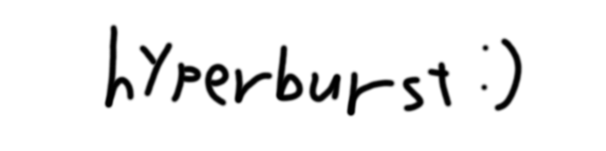

<p align="center"></p>

# Qwen3.8-Flash-Next: fast single-stream decode on one RTX PRO 6000 Blackwell Max-Q

[日本語版 README](README.ja.md)

This repository documents how we made **Qwen3.8-Flash-Next** (NVFP4 checkpoint) decode fast on
**one NVIDIA RTX PRO 6000 Blackwell Max-Q (96 GB, 300–325 W)**, and what did *not* work along the way.
It holds the patch series, the FlashInfer patches, the launch scripts, the benchmark harness,
stripped result files and the engineering notes.

The current release is on the fork's `flash-next-fast` branch (the 2026-10-27 update). It adds support
for four concurrent requests with long context while retaining the single-request optimizations.

> **Built on [jpezzulli/sglang-rtxpro6000](https://github.com/jpezzulli/sglang-rtxpro6000).**
> The Flash-Next model code in that fork (QSA, hyper-connections, PLE, native MTP, the memory pool)
> is an adapted import of the unmerged [SGLang](https://github.com/sgl-project/sglang) PR
> [#36497](https://github.com/sgl-project/sglang/pull/36497) (Qwen 3.8 Flash-Next; Qiaolin-Yu with
> co-authors ch-wan, ispobock, JustinTong0323, samuellees, YAMY1234, yhyang201, yizhang2077 and
> zijiexia), with the GDN MTP state adapted from the unmerged PR
> [#30967](https://github.com/sgl-project/sglang/pull/30967) (RecoverSSM). John Pezzulli's work in
> that fork is the SM120 integration and qualification: running it on this GPU, recovery CUDA
> graphs, HiCache/NIXL persistence and the validation behind it (see the fork's `CHANGES.md` and
> `PROVENANCE.md`). Our work is a
> 121-commit patch series on top of its `pennyroyal-main-sm120-final` branch (commit `16e5682aad`)
> plus ten patches to FlashInfer 0.6.17 (105 and seven of them for the September results below, the
> rest for the 2026-10-02 build). Please credit and read that project first.

## Results

Final release, 2026-10-27, public components (the fork's public token maps and the stock MTP head).
One request at a time, greedy, thinking on, screen off, one server start per build.
Cells: mean client-side decode tok/s (min–max) over 8 held-out prompts per genre.

| edition | code edit | English prose | Japanese prose | agent |
|---|---|---|---|---|
| `normal` | 611 (529–680) | 279 (272–285) | 288 (265–371) | 382 (357–410) |
| `hyperpro` | 657 (575–731) | 270 (259–294) | 288 (257–339) | 367 (350–389) |

- BetterBench 0.6.0, same public components: c=1 decode 369.9 (normal) and 342.3 (hyperpro) tok/s;
  4 concurrent, total 710.2 and 693.7 tok/s.
- One start per build: treat differences of a few percent as run-to-run noise.
- 2026-11-08, bundle 2: about +3% in one measurement window (431.0 → 443.6 tok/s, +2.91%),
  measured with a private MTP head, so absolute tok/s differ from the table; see [measurements and limitations](docs/bundle2-measurements.md).
- Full tables, acceptance and conditions: [2026-10-27 measured results](docs/updates/2026-10-27.md#measured-results).
- Older numbers: the historical September and 2026-10-02 work took single-request (batch size 1) decoding
  from about **130–210 tokens/s** to **about 260–670 tokens/s**, depending on the kind of text being
  generated; see [2026-09](docs/updates/2026-09.md) and [2026-10-02](docs/updates/2026-10-02.md).

## Before you use it

1. **GPU and model.** An RTX PRO 6000 Blackwell (96 GB). Other sm120 cards are untested.
   Weights are not included. Normal uses RadixArk/Qwen3.8-Flash-Next-NVFP4; hyper pro uses a local
   ThinkingCap overlay on that model.
2. **Host RAM.** About 100 GiB for the server process with the defaults (measured peak 100.5 GiB).
   Set `FLASH_NEXT_HICACHE_GB` lower to reduce the pool. A lower-memory setting is in
   [Requirements and how to run](docs/updates/2026-10-27.md#requirements-and-how-to-run).
3. **VRAM.** Up to 4 concurrent requests, 262,144-token context each, with 7 GB of VRAM left for the
   display (`DISPLAY_RESERVE_GB=7`). The opt-in expert tier lowers VRAM (see Editions and options).
4. **The first start compiles kernels with nvcc.** On the machine used by aiueo52 and contributors:
   14 modules, about 47 min (treat the time as an upper bound), peak RAM about 20 GiB. You need `nvcc`, a host C++ compiler and `ninja` on `PATH`.
5. **Outputs.** Hyper pro turns OEA on, an approximate MoE path; outputs change slightly.
   Greedy decoding was not bit-reproducible in the historical runs (see Limitations).
6. **Security.** The server binds to 127.0.0.1. Inference endpoints are unauthenticated by default.
   **Do not expose the server to a network without an authenticating proxy.**
   Details: [Server access and redaction](docs/updates/2026-10-27.md#server-access-and-redaction).

## Quick start

Clone the fork's branch, then build and activate a venv following the upstream
[`BUILD.md`](https://github.com/jpezzulli/sglang-rtxpro6000/blob/16e5682aad6e3335f38ec8d5711176278f12a086/BUILD.md)
(Python 3.12, PyTorch 2.13.0+cu130, FlashInfer 0.6.17 and a CUDA 13 toolkit with `nvcc`).
Only that venv plus `serve-fast.sh` is tested; **installing this branch with pip (for example `pip install ./python`) is not tested or supported**.

```bash
git clone --branch flash-next-fast https://github.com/aiueo52/sglang-rtxpro6000.git
cd sglang-rtxpro6000
# Build and activate the venv from the upstream BUILD.md before continuing.
python3 -m pip install flashinfer-python==0.6.17 ninja
python3 tools/assemble_flashinfer.py
export TARGET_MODEL=/path/to/Qwen3.8-Flash-Next-NVFP4   # hyper pro: the model-overlay-orig directory
CONC=4 FLASH_NEXT_EDITION=normal bash serve-fast.sh wa  # FLASH_NEXT_EDITION=hyperpro for hyper pro
```

The server serves the OpenAI-compatible API under `/v1` on `PORT` (default `8001`) with the model
name `flash-next`. All steps and settings: [Requirements and how to run](docs/updates/2026-10-27.md#requirements-and-how-to-run)
and the [fork README](https://github.com/aiueo52/sglang-rtxpro6000/blob/d21289fb923ac65b7b913b73c6e32a2fa2601e7b/README.md).

## Editions and options

| name | what it does | details |
|---|---|---|
| `normal` edition (default) | Qwen3.8-Flash-Next NVFP4 | [2026-10-27](docs/updates/2026-10-27.md) |
| `hyperpro` edition | ThinkingCap (Qwen3.8-Flash-Next NVFP4); OEA on | [Live OEA control](docs/updates/2026-10-27.md#live-oea-control-hyperpro) |
| `CONC=4` (default) / `CONC=1` | `CONC=1` is not a one-request admission limit; `CONC=6` is unvalidated | [Concurrency](docs/updates/2026-10-27.md#concurrency-and-adaptive-settings) |
| `EXPERT_TIER_K=<K>` (opt-in) | keeps K routed experts per MoE layer in VRAM; off by default | [Expert tier](docs/updates/2026-10-27.md#optional-expert-tier-lower-vram) |
| `HB_BUNDLE2=1` (fork default) | supplies the H35a and H38 flags for the measured `wa` configuration | [2026-11-08](docs/updates/2026-11-08.md) |
| `wa` profile | adaptive draft width | [How it works](docs/how-it-works.md) |
| `w4` / `w16` profiles | draft width 4 / draft width 16 (historical September tables) | [2026-09](docs/updates/2026-09.md) |

## How it works (short version)

At batch size 1, every decode step is a long chain of small GPU kernels that mostly stream weights
from DRAM. Speed comes from two multipliers: **tokens accepted per step** (speculative decoding) and
**step time**. The undated items describe the historical September and 2026-10-02 configurations.

- **Wider, cheaper speculation:** a reduced draft vocabulary (token map), wider draft widths,
  an adaptive width policy (`wa`) and a fine-tuned MTP head.
- **Dense weights as FP8** through a custom Triton W8A16 GEMV.
- **Fewer, cheaper kernels:** fused KV-FP8 store, hyper-connection mix, fused norms and more.
- **MoE glue inside FlashInfer:** six csrc patches to the CUTLASS fused-MoE path.
- **Singleton-route pruning:** changes the model's computation; set `PRUNE_TAU=0` to turn it off.
- **2026-10-02:** fixed-cost cuts, sampling fidelity fixes, rejection sampling, opt-in 524,288-token context.
- **2026-10-27:** up to 4 concurrent requests, a hierarchical prefix cache in host RAM, and MTP
  speculative decoding with an adaptive draft length.

Full text: [`docs/how-it-works.md`](docs/how-it-works.md). Evidence per item:
[`docs/optimizations.md`](docs/optimizations.md). Bandwidth floor: [`docs/roofline.md`](docs/roofline.md).

## What did not work

Rejected experiments are as useful as the adopted ones. Examples: dense FP8 via CUTLASS W8A8 GEMM,
n-gram drafting, NVFP4 dense GEMVs, a persistent megakernel and L2-cache prefetch.
Summary table: [`docs/what-did-not-work.md`](docs/what-did-not-work.md); all numbers: [`docs/rejected.md`](docs/rejected.md).

## Reproduce

For the 2026-10-27 fork, use the Quick start above. The following recipe rebuilds the historical 2026-10-02
configuration; see [`docs/reproduce.md`](docs/reproduce.md). In short: clone the base fork, `patches/sglang/apply.sh`,
build its venv, `patches/flashinfer/apply.sh`, download the NVFP4 checkpoint, use the public token map
`tokenmaps/public/public_49152.pt` or build your own (`tokenmaps/`), then `SGLANG_DIR=… TOKEN_MAP=… launch/serve-fast.sh wa` and measure with `bench/`
(`fnbench`).

## Limitations and measurement noise

Full list (historical September and 2026-10-02 configurations): [`docs/limitations.md`](docs/limitations.md).

- **Private components.** The fine-tuned MTP heads and private token maps are not published.
  The public components were slower in the measured runs (numbers in the updates).
- **Workloads are narrow.** Thinking is on, so most counted tokens are reasoning text.
- **Noise.** The GPU also drives a 4K 160 Hz desktop. Comparisons were made within one session.
- **Greedy is not bit-reproducible:** atomic adds make outputs and acceptance vary run to run.
- **The pruning changes the model.** "No significant difference" is not non-inferiority.

## Documentation map

| I want to | read |
|---|---|
| run the current release | [Requirements and how to run](docs/updates/2026-10-27.md#requirements-and-how-to-run), [fork README](https://github.com/aiueo52/sglang-rtxpro6000/blob/d21289fb923ac65b7b913b73c6e32a2fa2601e7b/README.md) |
| see all current results | [2026-10-27 measured results](docs/updates/2026-10-27.md#measured-results) |
| rebuild the historical 2026-10-02 stack | [`docs/reproduce.md`](docs/reproduce.md) |
| know what each optimisation does | [`docs/optimizations.md`](docs/optimizations.md), [`docs/how-it-works.md`](docs/how-it-works.md) |
| see what failed | [`docs/rejected.md`](docs/rejected.md), [`docs/what-did-not-work.md`](docs/what-did-not-work.md) |
| understand the speed limit | [`docs/roofline.md`](docs/roofline.md) |
| check how numbers were measured | [`docs/measurement.md`](docs/measurement.md), [`docs/limitations.md`](docs/limitations.md) |
| build my own token map | [`tokenmaps/README.md`](tokenmaps/README.md) |
| train my own MTP head | [`docs/train-your-own-mtp-head.md`](docs/train-your-own-mtp-head.md), [`docs/public-data-mtp-head.md`](docs/public-data-mtp-head.md) |
| read the dated history | [`docs/timeline.md`](docs/timeline.md), [`docs/lab-notes/`](docs/lab-notes/) |
| find a file in this repository | [`docs/repository-layout.md`](docs/repository-layout.md) |
| see every docs page | [`docs/README.md`](docs/README.md) |

## Updates

| date | what changed | full section |
|---|---|---|
| <a id="2026-11-08-bundle-2-preparation"></a>2026-11-08 | bundle 2 preparation: H35a and H38 launcher defaults, H40 FlashInfer patch | [2026-11-08](docs/updates/2026-11-08.md) |
| <a id="2026-10-27-update"></a>2026-10-27 | fork release: up to 4 concurrent requests, normal and hyperpro editions, optional expert tier | [2026-10-27](docs/updates/2026-10-27.md) |
| <a id="2026-10-update"></a>2026-10-02 | fixed-cost cuts, sampling fixes, rejection sampling, 524,288-token context | [2026-10-02](docs/updates/2026-10-02.md) |
| 2026-09 | September study: `w4` / `w16` / `wa` profiles, headline and final tables | [2026-09](docs/updates/2026-09.md) |

## Repository layout

What each top-level directory holds (patches, launchers, results, bench, kernels, token maps, MTP training):
[`docs/repository-layout.md`](docs/repository-layout.md).

## Model cards and licenses

Model weights have separate terms from this code. Read the model cards and linked licenses before use:

- [Qwen/Qwen3.8-Flash-Next](https://huggingface.co/Qwen/Qwen3.8-Flash-Next/tree/de4b8e4d43b917e7706784d8bb445c9af86a3540) (revision `de4b8e4`): the source model. Its LICENSE file is the Qwen Community License 1.0, which sets conditions on some commercial uses.
- [bottlecapai/ThinkingCap-Qwen3.8-Flash-Next-NVFP4](https://huggingface.co/bottlecapai/ThinkingCap-Qwen3.8-Flash-Next-NVFP4/tree/df3922b21fc28a8604cc9b31451495690d155194) (revision `df3922b`): its LICENSE file is the Qwen Community License 1.0, which sets conditions on some commercial uses.
- [RadixArk/Qwen3.8-Flash-Next-NVFP4](https://huggingface.co/RadixArk/Qwen3.8-Flash-Next-NVFP4/tree/7b719225242aacd3dbd3f9407468c2ee9a9d2594) (revision `7b71922`): its card lists the license as `other` and refers to the source model for terms.

In the fork: the two public maps and their two `.sources.json` files are offered under **CC BY-SA 4.0, not Apache-2.0**; see the attributions and source-use caveats in the fork's `THIRD_PARTY_NOTICES.md`.

- Removed for licensing reasons: the MUSA `fused_add_rms_norm_kernel.mu` and the Hunyuan3D `rasterizer.cpp`, `rasterizer_gpu.cu`, `rasterizer.h` and `mesh_processor.cpp`. The MUSA fused-add-RMSNorm kernel and Hunyuan3D rasterizer/mesh extensions are therefore unavailable in this release.

## Licence and credits

Apache License 2.0 (`LICENSE`), matching SGLang and FlashInfer; see `NOTICE` for the upstream
projects whose code the patches modify. A few patch hunks touch files derived from
flash-linear-attention (MIT) and causal-conv1d (BSD-3-Clause); those keep their own licences
(texts in `licenses/`, file list in `NOTICE`). The two public token maps (`tokenmaps/public/public_49152.pt`,
`tokenmaps/public/public_32768.pt` and their two source records) are derived from public datasets including
Wikipedia and are offered under CC BY-SA 4.0
with the attributions in `NOTICE`. No model weights are included. Qwen3.8-Flash-Next is under the Qwen Community License 1.0 (https://huggingface.co/Qwen/Qwen3.8-Flash-Next/raw/main/LICENSE), not Apache-2.0; this repo contains no model files. Much of the implementation
and measurement work was done with AI coding assistants under the author's direction; all numbers
come from the author's machine.
